# 🔒 Sovereign AI Workbench
### On-Premise Agentic AI Workbench for Confidential Industrial Work

[](https://www.python.org/)
[](https://fastapi.tiangolo.com/)
[](https://ollama.com/)
[-success.svg)](https://pytest.org/)
[](https://github.com/200510rj/Sovereign-AI)
[](https://opensource.org/licenses/MIT)

**Smart India Hackathon (SIH 2026) · Problem Statement: SIH26117 / PS 26117**  
**Organization:** Mangalore Refinery and Petrochemicals Limited (MRPL)  
**Category:** Software · **Theme:** Smart Automation

---

## 📌 Executive Summary

Industrial refining, petrochemical, and critical infrastructure facilities handle highly confidential data—process piping schematics, proprietary Standard Operating Procedures (SOPs), safety logs, and inspection reports. Transmitting this data to public cloud LLMs violates strict enterprise data sovereignty and security regulations.

**Sovereign AI** is an air-gapped, on-premise, agentic AI workbench running entirely on local enterprise hardware. It delivers end-to-end multimodal document ingestion, optical character recognition (OCR), semantic Retrieval-Augmented Generation (RAG), sandboxed code execution, and formal document reporting with **zero external network calls**.

---

## 🌟 Key Capabilities

- 🛡️ **100% Air-Gapped Sovereignty**: Operates without internet access, third-party API keys, or cloud telemetry with real-time socket connection auditing (`GET /network-status`).
- 🤖 **Autonomous Stage-4 Agentic Workflow**: Native ReAct tool-calling loop powered by local `qwen3.5:4b`. Autonomously chains tools: search knowledge base -> read document -> run Python code -> compile PDF deliverables.
- 🧠 **Dynamic Multi-Model Routing**: Automatically routes tasks to specialized open-weight models:
  - **General Reasoning & ReAct Agent**: `qwen3.5:4b` (Fast, grounded local reasoning with native function calling)
  - **Code Generation & Debugging**: `qwen2.5-coder:7b` (Industrial scripts & automation)
  - **Vector Embeddings**: `nomic-embed-text:latest` (High-density semantic embeddings with lexical fallback)
  - **Document OCR**: `glm-ocr:q8_0` (Scanned inspection sheets & diagrams)
- 📚 **Knowledge Base & Hybrid RAG**: High-accuracy semantic cosine similarity + keyword matching bonus over indexed PDFs, text SOPs, and OCR-extracted images with kerning normalization.
- 🔍 **Interactive Chunk Modal**: Clickable knowledge sources in chat with direct raw chunk inspection and confidence scores.
- 💻 **In-Browser Code Execution Sandbox**: Executes generated Python scripts in an isolated subprocess with stdout/stderr capture and timeout protection.
- 📄 **Automatic Document Deliverables**: Instant one-click generation and download of formatted `.pdf` (ReportLab), `.docx` (python-docx), and `.xlsx` (openpyxl) inspection reports.
- 🗄️ **Persistent Session Memory**: Built-in SQLite database (`data/sovereign.db`) for full conversation history and instant session switching.

---

## 💼 Resume Showcase Highlights

> *Ready-to-use bullet points for software engineering, machine learning, and full-stack developer resumes:*

- **Air-Gapped Industrial AI System**: Architected and deployed an end-to-end, on-premise AI workbench with zero outbound network calls, featuring real-time socket connection auditing via `psutil` to guarantee 100% enterprise data sovereignty.
- **Autonomous ReAct Agent Loop**: Implemented a multi-step ReAct agent using `qwen3.5:4b` with native function-calling, dynamically chaining local vector search, subprocess-isolated Python sandbox execution, and document compilation.
- **Hybrid Semantic RAG Pipeline**: Engineered high-precision retrieval combining `nomic-embed-text` cosine similarity with lexical keyword boosting over indexed technical SOPs, OCR-extracted diagrams, and engineering schematics.
- **Automated Deliverable Generation**: Built dynamic document compilation microservices generating formatted `.pdf` (ReportLab), `.docx` (python-docx), and `.xlsx` (openpyxl) industrial inspection deliverables directly from agent findings.
- **Test-Driven Rigor & Reliability**: Authored 23 automated unit and integration tests (Pytest, FastAPI TestClient) achieving 100% pass rate with graceful offline fallbacks and input validation.

---

## 🏗️ System Architecture & Visual Schematics

> 📐 **Full Interactive Diagrams & Gallery**: Explore all standalone interactive diagrams and SVG deliverables in [`docs/diagrams/`](docs/diagrams/README.md).

### 1. End-to-End System Architecture


### 2. Autonomous Stage-4 ReAct Tool Execution Loop


### 3. Air-Gap Industrial Security & Zero-Leakage Defense Hierarchy


### 4. Multimodal Ingestion & Hybrid RAG Retrieval Pipeline


---

## 🛠️ Technology Stack

| Layer | Technologies & Models |
|---|---|
| **Frontend UI** | HTML5, CSS3 Glassmorphism, Vanilla JS, Vendored Local Marked.js & Highlight.js |
| **Backend Framework** | FastAPI, Uvicorn, Pydantic, Python 3.10+ |
| **Local LLM Engine** | Ollama (`qwen3.5:4b`, `qwen2.5-coder:7b`) with native Function Calling |
| **OCR & Vision** | GLM-OCR (`glm-ocr:q8_0`), PyPDF with custom kerning normalization |
| **Vector Search** | Nomic Embeddings (`nomic-embed-text`), Hybrid Cosine & Lexical Keyword Search |
| **Agent Layer** | Autonomous ReAct Execution Loop (`agent.py`) |
| **Security & Audit** | Local Network Auditor (`psutil`), Subprocess Isolation Sandbox |
| **Database** | SQLite3 (`data/sovereign.db`) |
| **Report Generation** | ReportLab (`.pdf`), python-docx (`.docx`), openpyxl (`.xlsx`) |
| **Testing** | Pytest, FastAPI TestClient (23/23 Passing Tests · 100% Pass Rate) |

---

## 🚀 Quick Start Guide

### Step 1: Clone the Repository
```bash
git clone https://github.com/200510rj/Sovereign-AI.git
cd Sovereign-AI
```

### Step 2: Create & Activate Virtual Environment

**Using `uv` (Recommended - fast):**
```bash
uv venv --python 3.12 .venv
.venv\Scripts\activate   # Linux/macOS: source .venv/bin/activate
uv pip install -r requirements.txt
```

**Using standard `python`:**
```bash
python -m venv .venv
.venv\Scripts\activate   # Linux/macOS: source .venv/bin/activate
pip install -r requirements.txt
```

### Step 3: Launch Sovereign AI Backend
```bash
python -m uvicorn main:app --host 127.0.0.1 --port 8000 --reload
```

### Step 4: Open the Application
- Open your browser and go to: **`http://127.0.0.1:8000`**
- Interactive Swagger API Documentation: **`http://127.0.0.1:8000/docs`**

### Step 5: (Optional) Pull Local Inference Models
If running 100% local air-gapped inference:
```bash
ollama pull qwen3.5:4b
ollama pull qwen2.5-coder:7b
ollama pull nomic-embed-text
ollama pull glm-ocr:q8_0
```
*(Alternatively, enter any remote Ollama or Cloudflare tunnel URL directly in the UI sidebar without installing local models).*

---

## 🧪 Test-Driven Development (TDD) Suite

Run the full automated test suite:
```bash
python -m pytest tests/ -v
```

### Test Suite Structure (23 Tests · 100% Pass Rate):
- `tests/test_agent.py`: Validates individual tool execution (`search_knowledge_base`, `execute_python_code`, `generate_report`, `read_uploaded_document`) and `/agent` endpoint.
- `tests/test_dynamic_agent_tdd.py`: Validates end-to-end multi-step agent reasoning, document synthesis, and report deliverables.
- `tests/test_ollama_config.py`: Validates runtime Ollama endpoint configuration, Cloudflare tunnel connectivity, and dynamic token uncap logic.
- `tests/test_previous_phases.py`: Validates `/documents`, SQLite session lifecycle (`/sessions`), and sandboxed code execution (`/execute_code`).
- `tests/test_report_generator.py`: Validates `.pdf`, `.docx`, and `.xlsx` document generation and file download endpoints.
- `tests/test_web_search.py`: Validates multi-source web search synthesis (`/search`), fallback mechanisms, and agent tool execution.

---

## 📡 API Reference

| Method | Endpoint | Description |
|---|---|---|
| `GET` | `/` | Serves the Sovereign AI Workbench web application |
| `GET` | `/documents` | Lists all indexed knowledge base files and chunk metrics |
| `POST` | `/upload` | Uploads and processes `.pdf`, `.txt`, `.md`, or image files with OCR |
| `POST` | `/chat` | Multi-turn conversational chat with automatic tool/model routing |
| `POST` | `/agent` | Autonomous ReAct agent loop executing multi-step tool calls |
| `POST` | `/search` | Real-time multi-source web search query synthesis |
| `GET` | `/config/ollama` | Gets the active Ollama inference endpoint URL |
| `POST` | `/config/ollama` | Sets the active Ollama inference endpoint URL |
| `POST` | `/config/ollama/test` | Tests connectivity and model inventory of any Ollama endpoint |
| `GET` | `/network-status` | Real-time air-gap connection auditor verifying 0 external network calls |
| `GET` | `/sessions` | Lists all stored chat conversation sessions |
| `GET` | `/sessions/{id}/messages` | Fetches historical messages for a given session |
| `DELETE` | `/sessions/{id}` | Deletes a conversation session |
| `POST` | `/execute_code` | Runs Python code inside the local sandbox environment |
| `POST` | `/generate_report` | Compiles inspection findings into `.pdf`, `.docx`, or `.xlsx` |
| `GET` | `/download_report/{name}`| Downloads generated report deliverables |

---

## 👥 Team & Attribution
- **Developed for:** Smart India Hackathon (SIH 2026)
- **Problem Statement ID:** PS 26117
- **Target Organization:** Mangalore Refinery and Petrochemicals Limited (MRPL)
- **License:** [MIT License](LICENSE)
